### Aron Honold

Gestaltung und Code, meist beides am selben Tag. Was fertig ist, steht im Netz:

| Adresse                                            | Was es ist                                         |
| -------------------------------------------------- | -------------------------------------------------- |
| [aron.graphics](https://aron.graphics)             | Portfolio. Zweisprachig, statisch.                 |
| [tools.aron.graphics](https://tools.aron.graphics) | Werkzeuge, die vollständig im Browser rechnen.     |
| [ui.aron.graphics](https://ui.aron.graphics)       | Die eigene Bausteinsammlung.                       |

<a href="https://aron-graphics.github.io/aron-graphics/" title="Dieselbe Karte, bedienbar">
<picture>
  <source media="(prefers-color-scheme: dark)" srcset="assets/heatmap-dark.svg">
  <source media="(prefers-color-scheme: light)" srcset="assets/heatmap-light.svg">
  
</picture>
</a>

<b>Die Karte ist anklickbar</b> — eine README nimmt keinen Zeiger entgegen, <a href="https://aron-graphics.github.io/aron-graphics/">die Seite dahinter</a> schon: dort läuft <a href="https://vuesax.com/c/vs-calendar-heatmap"><code>vs-calendar-heatmap</code></a> aus dem Vuesax-Katalog selbst, mit Tooltip, Klick und Tastatur. Hier ist er als statisches SVG nachgezeichnet, bis auf die Bewegung, die ein Bild mitbringen darf: Kaskade, Zähler und den Rundgang aus dem <code>demo</code>-Modus. <a href="heatmap.mjs"><code>heatmap.mjs</code></a> holt den Beitragskalender über GraphQL und zeichnet beide Fassungen; <a href=".github/workflows/heatmap.yml">ein Workflow</a> stößt das jede Nacht an.

---

Selbst nachzeichnen: `node heatmap.mjs --login <name> --out assets`. Ohne Token zeichnet das Skript die Demo-Reihe der Vuesax-Quelle, mit `--scale max` die originale Farbrampe des Bausteins, und `--locale en-US --unit contributions` stellt es auf Englisch.
